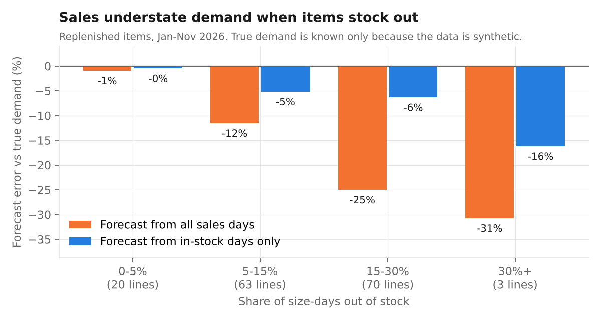
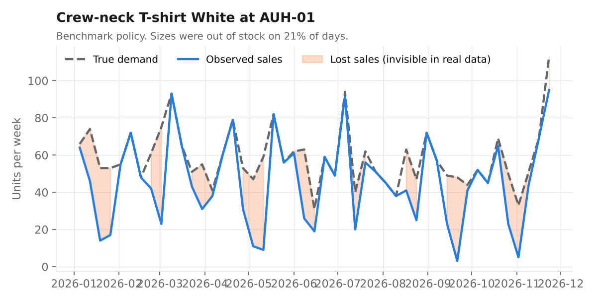
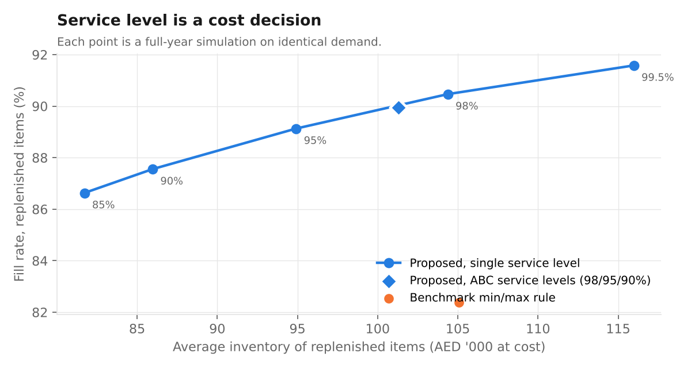

# Retail Floor → Planning Desk

**An inventory planning model for a hypothetical four-store fashion retailer in Abu Dhabi.** It decides, for every store and SKU, whether to **replenish, transfer, mark down or hold**, and it uses different logic for basics and for seasonal lines, as real planning teams do.

> **All data is synthetic** and comes from a seeded generator (`config/scenario.json`). The stores, SKUs and suppliers are invented. Results are simulated scenario outcomes, not savings at any real retailer. The project draws on my store-floor experience at Primark and Uniqlo for the *kinds* of problems it models; it does not use or reconstruct either company's data, and it does not describe their supply chains.

**[Interactive dashboard](docs/index.html)** · **[Excel reorder-point calculator](excel/reorder_point_calculator.xlsx)** · **[SQL](sql/)** · **[Quality report](outputs/quality_report.md)**

---

## The business problem

Picture four stores. One has far too many basic T-shirts. Another keeps running out of M and L while XS and XXL hang on the rail. A third has summer stock piling up in the stockroom. Store teams reorder with a simple min/max rule set once a year.

The planning desk needs to answer four questions every week:

| Question | Where it applies |
|---|---|
| **Replenish** – order more from the supplier? | Basics and core accessories |
| **Transfer** – move stock from a store that has too much to one that will run out? | All lines |
| **Mark down** – cut the price to sell through before the season ends? | Seasonal lines |
| **Hold** – do nothing? | Everything, most of the time |

## What I found

| | Benchmark (min/max rule) | Proposed policy | Change |
|---|---:|---:|---:|
| Fill rate, replenished items | 82.4% | 89.9% | **+7.6 pts** |
| Lost units, replenished items | 16,938 | 9,666 | −43% |
| Average inventory at cost | AED 236,300 | AED 219,277 | **−7.2%** |
| Summer season sell-through | 82.3% | 99.0% | +16.6 pts |
| Season-end leftover units | 1,933 | 246 | −87% |
| Ramadan & Eid capsule revenue | AED 492,189 | AED 488,576 | −0.7% |
| Transfer cost | AED 0 | AED 34,112 | new cost |
| Purchase order lines raised | 6,376 | 9,138 | +43% (more, smaller orders) |
| **Net contribution**¹ | AED 4,387,354 | AED 4,652,946 | **+AED 265,592 (+6.1%)** |

¹ Gross margin − holding cost (25% a year) − transfer cost − loss on season-end leftovers sold at 30% of cost.

Both policies run on **identical demand**: same seed, same random draws, same supplier lead times. On five further seeds the proposed policy raised net contribution every time (+AED 268k to +AED 321k) and lifted replenished fill rate by 8.1–9.0 points. The Ramadan capsule is the honest exception: for a short, sharp event season, early markdowns did not beat a simple late markdown (better in 2 of 5 seeds).

### 1. Sales are not demand



When a size sells out, sales stop at the stock level. A forecast built on raw sales learns that the item sells less than it really does, orders less, and stocks out again. Because the data is synthetic I know the true demand, so I can measure this:

* For lines out of stock on 15–30% of size-days, the average of all sales days **understates demand by 25%**.
* Averaging only days that **ended with stock** cuts that error to 6%.
* Using that correction, the model estimated **1,930 lost units** in the last 28 days. The true number was 1,960.



### 2. Basics and seasonal lines need different logic

* **Basics** (T-shirts, jeans, socks) are replenished continuously, so they get a **reorder point**.
* **Seasonal lines** (Ramadan & Eid, Summer, Autumn/Winter) are bought once before the season. Running a reorder point on a seasonal jacket makes no sense. Their levers are **transfer, markdown and hold**, decided by a weekly sell-through review.

### 3. Supplier reliability belongs inside the safety stock

The textbook formula `SS = z·σd·√L` assumes the lead time never changes. Supplier C's lead time swings by ±7.5 days on a 21-day average, so the model uses

```
SS = z · √( L·σd² + d²·σL² )
```

For Supplier C's items this gives **1.7× the safety stock** of the textbook version. The what-if page then tests supplier *delays* as a separate scenario on top.

### 4. Service level is a cost decision



Going from 95% to 99.5% buys 2.5 points of fill rate for 22% more inventory. Service levels are therefore set by ABC class: A 98%, B 95%, C 90%. The benchmark rule sits below and to the right of the curve: it holds more stock and still delivers less.

Fill rate stays below the target service levels (89.9% against 90–98%) for three reasons worth knowing: a cycle service level is not a fill rate, the distribution centre can only ship 373 units a day, and stock split across six sizes runs out size by size.

## Does the method find the problems I planted?

The weakness of synthetic data is that I designed the problems myself. So the honest test is not "what did I discover?" but **"does the method find the planted problems, and rank them correctly?"**

| | What I planted | What the method showed | Verdict |
|---|---|---|---|
| P1 | AUH-03 starts with 4× normal stock of four basic T-shirts | They are 4 of the top 5 days-of-cover lines on 31 Jan; AUH-03 was a transfer donor 40 times (445 units) | Found |
| P2 | Summer buy 60% too high at AUH-02, 40% too low at AUH-01 | Benchmark leaves 1,352 summer units at AUH-02 and 0 at AUH-01; the biggest proposed transfer flow is AUH-02 → AUH-01 (1,071 units) | Found |
| P3 | Supplier C has highly variable lead times | Ranked most variable (sd 7.5 days, 35% of orders >3 days late) | Found |
| P4 | Supplier B lead time (28 days) is longer than the benchmark trigger (21 days) | Benchmark fill on Supplier B items 74.0% vs 90.1% elsewhere; proposed lifts it to 88.9% | Found |
| P5 | Opening stock split evenly across sizes | No policy can fix the first six weeks (nothing lands before the 28-day lead time). From week 7, broken size runs fall from 31.7% to 20.8% | Found after one lead time |

## How it works

```
config/scenario.json ──► src/generate.py ──► true demand (unknown to any policy)
                                   │
                                   ▼
                          src/engine.py  ── simulate a policy day by day
                                   │        sales = min(demand, stock)
                                   ▼
             data/  (what a retailer's systems would hold: stock, sales, orders, receipts)
                                   │
                                   ▼
            sql/*.sql (DuckDB) ──► outputs/  ──► docs/index.html (dashboard)
                                   │
                                   ▼
          src/snapshot.py ──► planner's action list on 30 Nov 2026
```

### The dataset

* **4 stores**: a tourist-heavy flagship, a residential family mall, a compact neighbourhood store and a waterfront lifestyle store, each with its own demand pattern, size curve and seasonality.
* **70 SKUs**: 27 basics, 25 seasonal, 18 accessories; 1,260 store-SKU-size lines; 334 days.
* **5 suppliers** with lead times from 6 to 28 days and different reliability.
* **Abu Dhabi calendar**: Ramadan (with the Eid-outfit peak in the last ten nights), Eid al-Fitr and Eid al-Adha, back to school, White Friday, National Day, the UAE Saturday–Sunday weekend, summer heat suppressing outerwear, and tourists in winter. Islamic calendar dates are approximate.
* **Promotions**, markdown price response (elasticity 1.8), demand noise, and a daily DC dispatch limit.

### Modelling choices

* **No backorders.** In a shop, a customer who can't find the size leaves. Inventory position = on hand + on order + in transit.
* **Plan at style level, allocate to sizes.** Daily demand for one size in one store is usually 0, 0, 1, 0, 2, so a normal-distribution reorder point per size breaks down. The model plans the style and splits orders using each store's own size curve, estimated from in-stock days.
* **Prioritisation under a constraint.** When store requests exceed what the DC can ship, orders are ranked by *expected shortfall before the order could land × unit margin*. The benchmark serves first come, first served.
* **Transfer rule (basics).** Transfer only when the receiving store will run out before a new order could arrive, the donor has more than 45 days of cover and keeps 30, and the expected margin saved (80% sell probability) beats AED 60 + AED 1.5 per unit.
* **Seasonal review (weekly).** Project demand to season end from in-stock-day sales and the planning calendar. Transfer when one store is short even at 80% of forecast and another is long even at 125%. Mark down 20%, then 35%, if the chain is heading for more than 35% leftover; 40% clearance in the last 10 days.
* **Benchmark policy.** Min = 21 days and order quantity = 28 days of the annual plan, set once; ignores lead time and seasonality; standard buying size ratio; no transfers; 40% markdown in the last 21 days of a season.
* **AI's role.** AI helped write and test the simulator, the SQL and the dashboard code. Every replenishment quantity comes from the deterministic formulas in `src/planning.py`, not from a language model.

## Quality checks

`python tests/quality_checks.py` → [outputs/quality_report.md](outputs/quality_report.md). All 14 pass, including:

* stock balance (opening + receipts + transfers in − transfers out − sales − clearance = closing) on all 420,840 rows
* no negative inventory; sales never exceed stock; lost = demand − sales
* lead times are whole days between 2 and 90, and receipt − order date = lead time
* the same seed reproduces identical results; both policies face identical demand
* raising the service level raises both inventory and fill rate; a supplier delay lowers fill rate for both policies

## Repository

| Path | What it is |
|---|---|
| `config/` | Every generator setting, the SKU master and the planted problems |
| `src/generate.py` | Builds the synthetic world (calendar, demand, lead times, opening stock, seasonal buys) |
| `src/engine.py` | Day-by-day simulator for both policies |
| `src/planning.py` | The formulas: safety stock, reorder point, ABC/XYZ, transfer test |
| `src/snapshot.py` | Planner's action list from observed data only |
| `src/run_all.py` | Rebuilds everything |
| `sql/` | DuckDB queries: inventory health, trend, ABC/XYZ, size availability, stores, suppliers, censored demand |
| `data/` | The "observed" history (benchmark run) plus `truth_demand_daily.parquet`, which exists only because the data is synthetic |
| `outputs/` | Query results, action lists, policy comparison, what-if grid, charts |
| `docs/index.html` | The dashboard (self-contained; works on GitHub Pages) |
| `excel/` | Reorder-point calculator with live formulas |
| `STUDY_GUIDE.md` | How every number is produced, and interview answers |

## Run it

```bash
pip install -r requirements.txt
python src/run_all.py          # about 2-3 minutes (includes 63 what-if runs and 5 extra seeds)
python src/charts.py
python src/build_site.py       # rebuilds docs/index.html
python src/build_excel.py
python tests/quality_checks.py
```

To view the dashboard on GitHub Pages: Settings → Pages → deploy from branch, folder `/docs`.

## Limitations

* Synthetic data with problems I planted myself.
* The model is given the planning calendar (Ramadan, Eid, school, promotions) exactly; in practice those effects must be estimated.
* One echelon: lead times run supplier → store through a DC with a daily dispatch limit but unlimited stock.
* Lost sales are valued at lost margin only, with no customer-goodwill cost; order handling cost is not modelled, although the proposed policy raises 43% more order lines.
* Seasonal markdown thresholds were set once by judgement, not optimised, and the Ramadan capsule shows no gain.
* Six seeds are a robustness check, not a statistical proof.

## How I'd deploy this at a real retailer

1. Daily sales, stock-on-hand and open purchase orders from the ERP and POS.
2. Clean master data first: size scales, supplier lead times, pack sizes, which SKUs are basics and which are seasonal.
3. Add the business rules this model leaves out: minimum display quantities, case packs, DC stock limits, store capacity.
4. Run it as a recommendation engine. A planner reviews and approves every order, transfer and markdown, and their overrides are tracked to improve the rules.
